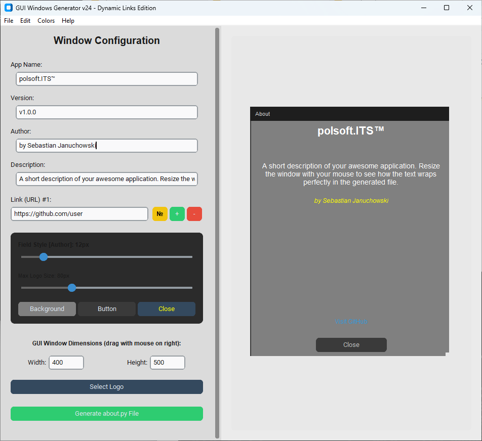

<p align="center">
  
</p>

<h1 align="center">GUI Windows Generator</h1>

<p align="center">
  A powerful visual designer for creating modern, customizable <strong>About</strong> dialog windows for <strong>CustomTkinter</strong> Python applications — with real-time live preview and one-click code export.
</p>

<p align="center">
  
  
  
  
  
</p>

---

## 🧩 Overview

**GUI Windows Generator** is a professional GUI tool that lets you visually design and instantly export ready-to-use `about.py` Python modules for your CustomTkinter projects. No more hand-coding About dialogs — configure every detail in real time, see the result immediately in the live preview panel, and generate a clean, standalone Python file with a single click.

---

## ✨ Features

### 🎨 Visual Design & Live Preview
- **Real-time preview** panel that mirrors the final About window appearance
- **Drag-to-resize** the preview window using its edges and corners to set exact dimensions
- Instantly reflects all changes — text, colors, fonts, and layout update live

### 📝 Text & Content Customization
- Editable fields: **App Name**, **Version**, **Author**, **Description**
- **Dynamic Links** — add up to 5 clickable URL links with custom display labels
- Set a custom alias/label for each link via the dedicated label dialog (`№` button)
- **Unicode text formatting** — apply Bold, Italic, Underline, and Strikethrough directly in the editor

### 🖼️ Logo & Branding
- Load a custom logo (`.png`, `.ico`, `.jpg`, `.gif`)
- **Logo size slider** — scale the logo from 30 px to 200 px with a live preview update

### 🎭 Themes & Templates (15+ built-in presets)
| Category | Themes |
|---|---|
| **Standard** | Modern Dark (Studio), Clean Light (Apple Silk), Cyberpunk Neon |
| **IT / Dev** | Hacker Matrix, Dracula Spec Pro |
| **OS Styles** | Windows 11 Acrylic, macOS Sequoia, macOS Light, Ubuntu Yaru |
| **Retro** | MS-DOS Terminal, Amiga OS, Commodore 64, Atari ST, ZX Spectrum |
| **Frames** | Compact Box, Wide Panoramic |

### 🎨 Color Controls
- Background color picker for the About window
- Close button background color picker
- Close button text color picker
- Per-field text color picker (via Edit menu or right-click context menu)

### 🖋️ Font Size Control
- Per-field **font size slider** (8–40 px) with live preview refresh
- Independently control sizes for: Title, Version, Description, Author, and each Link

### 💾 Code Generation & Export
- Generates a clean, self-contained `about.py` module
- Exported file includes all settings: colors, fonts, logo, links, dimensions
- The generated `AboutWindow` class works as both a **standalone app** and an **importable module** for integration into any CustomTkinter project

### 🖱️ Context Menu
- Right-click any text field to access Cut, Copy, Paste, and Unicode text styling options

### ℹ️ Application Menu
- **File** — Select logo, Generate file, Exit
- **Edit** — Cut, Copy, Paste, Bold, Italic, Underline, Strikethrough
- **Colors** — Quick access to all color pickers
- **Help** — About dialog

---

## 📦 Requirements

```
customtkinter>=5.2.0
Pillow>=10.0.0
```

Install dependencies:

```bash
pip install customtkinter Pillow
```

---

## 🚀 Getting Started

```bash
# Clone the repository
git clone https://github.com/polsoft-IT/About_Windows_Generator.git
cd About_Windows_Generator

# Install dependencies
pip install customtkinter Pillow

# Run the English version
python About_Windows_Generator_v24_en.py

# Run the Polish version
python Generator_Okna_About_v24_pl.py
```

---

## 📁 Project Structure

```
About_Windows_Generator/
├── About_Windows_Generator_v24_en.py   # Main app — English UI
├── Generator_Okna_About_v24_pl.py      # Main app — Polish UI
├── lang_en.py                          # English language strings module
├── templates.py                        # Built-in visual themes & HQ color engine
├── Screenshot.png                      # Application screenshot
└── description.txt                     # Short program description
```

---

## 🛠️ How It Works

1. **Fill in** the App Name, Version, Author, Description, and web links
2. **Load** a logo if needed and adjust its size with the slider
3. **Pick a theme** from the menu or customize colors manually
4. **Resize** the preview window by dragging its edges
5. **Click** `Generate about.py File` and save it anywhere
6. **Import** the generated `AboutWindow` class into your project:

```python
from about import AboutWindow

# Inside your CustomTkinter app:
AboutWindow(parent=self)
```

---

## 📸 Screenshots

<p align="center">
  
</p>

---

## 👤 Author

**Sebastian Januchowski**  
Company: **polsoft.ITS™ Group**

- 🌐 GitHub: [polsoft-IT](https://github.com/polsoft-IT)
- 📧 Email: [polsoft.its@mail.com](mailto:polsoft.its@mail.com)

---

## 📄 License

This project is licensed under the **MIT License** — feel free to use, modify, and distribute it in your own projects.

---

<p align="center">Made with ❤️ using Python & CustomTkinter</p>

